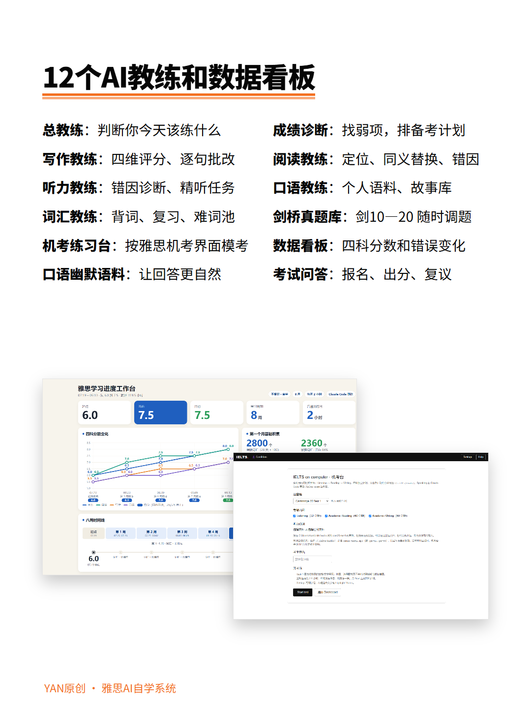

# IELTS AI 学习系统

> 免费开源版 v1.0：4 个 Claude Code Skill，装上就能用。<br>
> 完整版已更新到 **V5.0**：12 个 AI 教练 + 雅思 GO 急救模式 + 32 份 PDF + 49 万字分科专题知识库 + 剑 10–20 真题库 + 机考台 + 数据看板。

[免费版安装](#免费版怎么安装) · [V5.0 有什么](#v50) · [查看完整产品页](https://zhanlinyan.com/products/ielts-skills)

<p align="center">
  
  
  
  
</p>

---

## 先说清楚：这个仓库里有什么

这个仓库公开的是 **v1.0 免费版**，包括 4 个无状态 Skill：

| Skill | 能帮你做什么 | 常用说法 |
|---|---|---|
| `/ielts` | 了解目标分、考试日期和今天要练什么 | “我要备考雅思” |
| `/ielts-writing` | 写作四维评分、逐句批改、改写对比、审题 | “批改这篇作文” |
| `/ielts-reading` | 阅读错题分析、同义替换、T/F/NG 拆解 | “这道阅读为什么错” |
| `/ielts-speaking` | Part 2 故事、Part 3 追问和表达训练 | “帮我准备口语素材” |

免费版完全无状态，不写学习档案，不需要 npm、Python 或数据库。4 个 Skill 都是 Markdown 文件，采用 MIT License，可以直接使用、修改和二次开发。

**完整版 V5.0 不在这个公开仓库里。** 它是单独交付的付费产品，不会因为克隆本仓库自动获得。

---

<a id="v50"></a>

## 完整版 V5.0：既能考前急救，也能长期训练

免费版适合体验 AI 怎么陪你练雅思。V5.0 不只是多了几个 Skill：它把**考前急救、模板与 PDF、分科专题知识库、真题训练和长期学习记录**放进了同一套系统。

只剩 48 小时，可以直接说“雅思 Skill 救我”，让它按小时倒排任务；还有两周或两个月，就按你的考试日期、目标分和当前水平规划训练。做完以后，它会批改、归因、保存记录，再根据结果安排下一次复习。

### 这次 V5.0 真正增加了什么

| 核心部分 | 不是一个空目录，而是这些内容 |
|---|---|
| 雅思 GO 急救模式 | 考前 48 小时自动进入止损冲刺：先扣除睡眠、吃饭、交通和到场时间，再按小时排任务，一次只推进一项，最后生成考前一页卡 |
| 12 份考前急救 PDF | 写作急救模板与句型、三天速成、50 个观点和 50 个例子；口语 P1/P2/P3 题库、万能故事和万能理由；听力、阅读急救清单 |
| 模板与备考工具 | Task 1 / Task 2 模板、个人句库、口语故事卡、每日打卡表、周计划，以及两个月、14 天、48 小时三条备考路线 |
| 分科专题知识库 | 写作题型、观点、案例和范文库；口语 46 个 P1 话题、72 张 P2 题卡、74 个 P3 话题；听力和阅读题型、错因、复习与复测方法 |
| 32 份正式 PDF | 从“拿到以后先看什么”到四科系统指南、规划、安装、社群和更新说明，打开就能学，不需要先会用 AI |
| AI 长期训练系统 | 12 个教练会保存你的作文、错题、词汇、口语故事、模考和分数趋势，下一次接着练，而不是每次重新解释自己 |

### 完整交付清单

| 模块 | 你能拿到什么 |
|---|---|
| 12 个 AI 教练 | 总入口、成绩诊断、听力、口语、阅读、写作、词汇、真题库、机考台、数据看板、口语幽默语料、考试问答 |
| 雅思 GO 急救 | 剩余 48 小时自动倒排计划，按个人强弱项调用急救资料，完成后生成考前一页卡 |
| 剑桥雅思真题库 | 剑 10–20，共 43 套正文完整、可以直接练习的测试 |
| 32 份 PDF 资料 | 12 份考前急救资料、3 份备考规划、2 份 AI 安装与使用指南、11 份系统备考资料，以及总说明、更新说明、社群说明和赠品 |
| 分科专题知识库 | 四科完整备考指南，听力与阅读急救清单，口语当季话题与原创语料，写作模板、范文、题型、观点库和案例库 |
| 49 万字学习内容 | 听力 3.2 万字、口语 22.8 万字、阅读 4.3 万字、写作 17.9 万字，另有安装和使用说明 |
| 4 份词表 | 词汇训练、间隔复习、难词池和自定义词表导入 |
| 机考练习台 | 在浏览器里计时做听力、阅读和写作；交卷后保存模考记录 |
| 本地数据看板 | 查看四科分数趋势、写作雷达、阅读题型、听力错因、词汇复习和模考记录 |
| 雅思答疑社群 | 雅思老师、正在备考的同学和已经考出高分的同学一起答疑、监督和同步更新 |
| 完整交付包 | 安装指南、使用手册、常见问题、升级说明和 258 页《Claude Code 非程序员完全落地指南》 |
| 后续更新 | 已购用户免费获得题库、教练和系统的新版本 |

### 12 个教练分别负责什么

| Skill | 负责什么 |
|---|---|
| `ielts` | 总入口：判断今天该练什么，必要时进入考前急救 |
| `ielts-diagnose` | 成绩差距、目标分组合和个人备考计划 |
| `ielts-writing` | 四维评分、逐句批改、审题和复测 |
| `ielts-reading` | 定位、同义替换、题型判断和错因统计 |
| `ielts-listening` | 错题分类、精听、听写和倍速训练 |
| `ielts-speaking` | 个人经历档案、当季题卡、故事和 Part 3 训练 |
| `ielts-vocab` | 每日背词、间隔复习、测试和难词池 |
| `ielts-bank` | 从剑 10–20 按书、套题、科目调用真题 |
| `ielts-exam` | 全真机考练习和口语模考 |
| `ielts-dashboard` | 启动并查看本地学习数据看板 |
| `ielts-slang` | 用自己的真实经历练自然、有记忆点的口语 |
| `ielts-faq` | 报名、费用、出分、复议和评分规则等常识 |

### 你可以直接这样用

```text
我要备考雅思。考试日期是 12 月 14 日，目标总分 7.5，
目前听力 6.5、阅读 7、写作 6、口语 6。
请先诊断，再给我安排今天的训练。
```

```text
我做完了剑 18 Test 2 阅读。
这是我的答案和错题，帮我判断每一题为什么错，
保存记录，再安排下一次专项训练。
```

```text
按官方四项标准批改这篇 Task 2。
逐句指出问题，只让我先改最影响分数的一项，
改完以后换一道题复测。
```

```text
我明天考试，还能学习 6 小时。
开启考前急救，保留睡觉、证件和出行时间，
一次只给我一个任务。
```

### V5.0 怎么安装

V5.0 适配 Claude Code 和 Codex。把交付包解压到电脑上的稳定位置，再把文件夹路径发给你正在用的 Agent：

```text
请安装这个雅思 AI 学习系统。
把 12 个雅思教练、真题知识库、词表、数据看板和机考练习台全部安装完成。
安装后检查真题查询和数据看板能否正常打开，全部完成后告诉我。
不要修改原始交付包。
```

Dashboard 和机考台需要 Node.js 18 或更高版本。Claude Code、Codex 之外的 Agent，只要能读取本地 Skill、运行 Node.js 并写入本地文件，也可以按各自的 Skill 规则安装；不同 Agent 的目录和触发方式不完全相同。

### 获取 V5.0 完整版

完整版价格：**¥299**。下单后获得完整交付包、雅思答疑社群和后续更新。

- 产品详情：[zhanlinyan.com/products/ielts-skills](https://zhanlinyan.com/products/ielts-skills)
- 小红书：搜索 `yan的ai世界`，在橱窗下单
- 微信：`Yyyzzzll410`，备注“雅思 V5”

> AI 给出的分数和分析属于训练反馈，不是官方成绩。本产品不是 IELTS、British Council、IDP 或 Cambridge 官方产品。

---

## 免费版怎么安装

### 前提

先安装 [Claude Code](https://docs.claude.com/en/docs/claude-code)。

### 方法一：直接复制

```bash
# macOS / Linux
cp -r ielts ielts-writing ielts-reading ielts-speaking ~/.claude/skills/
```

```powershell
# Windows PowerShell
Copy-Item -Recurse ielts, ielts-writing, ielts-reading, ielts-speaking $env:USERPROFILE\.claude\skills\
```

### 方法二：克隆仓库

```bash
git clone https://github.com/YANZHANLIN/ielts-claude-skills.git
cd ielts-claude-skills
cp -r ielts ielts-writing ielts-reading ielts-speaking ~/.claude/skills/
```

安装完成后重启 Claude Code，输入 `/ielts`，或者直接说“我要备考雅思”。

---

## 免费版怎么用

### 批改作文

```text
/ielts-writing
[粘贴题目、作文和目标分]
```

它会给出四维评分、句子级问题、目标分版本和提分优先级。

### 分析阅读错题

```text
/ielts-reading
[粘贴文章、题目、你的答案和标准答案]
```

它会逐题拆解错因，提取同义替换，并分析 T/F/NG 的证据链。

### 准备口语

```text
/ielts-speaking
帮我准备 Part 2：描述一次旅行。
```

它会生成 Part 2 回答、Part 3 追问和关键表达。

---

## 仓库结构

```text
ielts-claude-skills/
├── ielts/SKILL.md
├── ielts-writing/SKILL.md
├── ielts-reading/SKILL.md
├── ielts-speaking/SKILL.md
├── assets/v5/
├── README.md
└── LICENSE
```

每个免费 Skill 都是一个文件夹加一个 `SKILL.md`。Claude Code 通过文件里的 `name` 字段识别和触发。

---

## 二次开发

1. Fork 本仓库。
2. 修改对应的 `SKILL.md`。
3. 重新复制到 `~/.claude/skills/`。
4. 重启 Claude Code。

你可以修改教练人格、评分标准、工作模式和 Skill 之间的分工，也可以把这套结构改成托福、GRE 或其他学习场景。

---

## License

[MIT](./LICENSE)

本仓库中的 v1.0 免费版可以使用、修改和商用。V5.0 完整版及其交付资料不适用本仓库的 MIT License。

---

## 反馈

免费版问题请提交 [Issue](https://github.com/YANZHANLIN/ielts-claude-skills/issues) 或 Pull Request。V5.0 的安装和使用问题请通过购买渠道联系。
